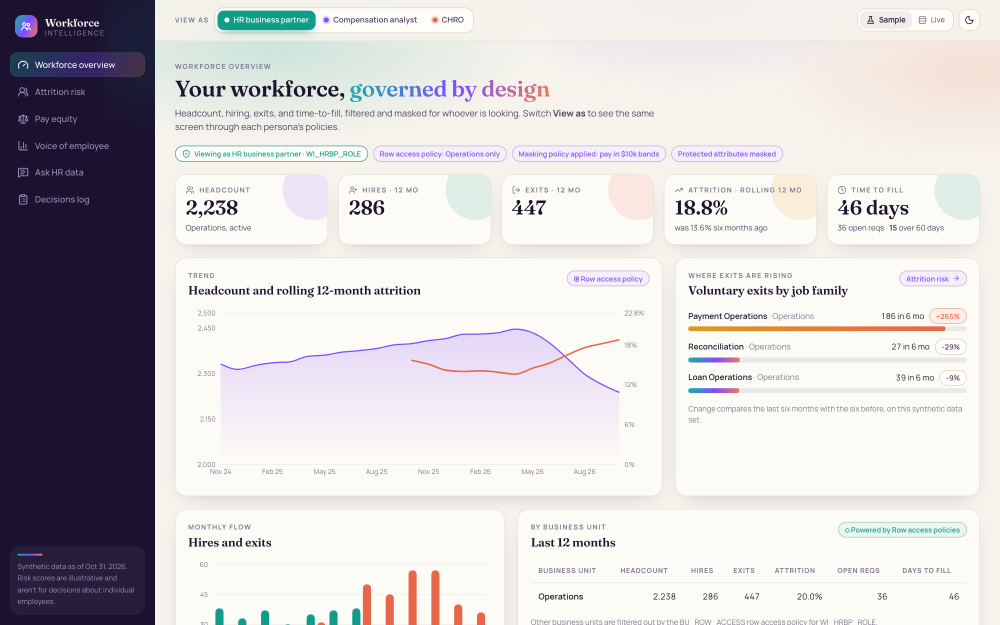

# Workforce Intelligence with Governed HR Data

Give HR business partners governed, plain-English answers on headcount, attrition risk, and pay
equity, with sensitive fields masked by role.

**[Landing page](https://sfc-gh-ooral.github.io/sfguide-workforce-intelligence/) · [Try the example in your browser](https://sfc-gh-ooral.github.io/sfguide-workforce-intelligence/try/)** (no account needed)



HR analytics often depends on data engineering for every new report, attrition modeling runs
quarterly in spreadsheets, and compensation, performance, hiring, and survey data sit in separate
exports. This example brings them together in one app on Snowflake. Three personas see the same
screens through different policies:

| Persona | Snowflake role | What Snowflake enforces |
|---|---|---|
| HR business partner | `WI_HRBP_ROLE` | Row access: Operations only. Pay masked to $10k bands. Gender and ethnicity masked. |
| Compensation analyst | `WI_COMP_ROLE` | All business units, exact pay, and protected attributes for equity analysis |
| CHRO | `WI_CHRO_ROLE` | Aggregation policy: every group must have at least 10 people, and smaller groups are merged into a remainder row. Pay gaps masked for small cells. |

The app has six screens:

1. **Workforce overview:** headcount, hires, exits, rolling 12-month attrition, and time to fill, by business unit.
2. **Attrition risk:** teams (not individuals) ranked by modeled risk, with top drivers. The drill-down shows the hiring backlog, an AI conversation plan, and employee rows for the compensation analyst only.
3. **Pay equity:** the regression-adjusted gap by job family and level, cohorts below band, and an AI **Explain** panel.
4. **Voice of employee:** survey themes and sentiment over four cycles, with an AI summary.
5. **Ask HR data:** a Cortex Agent for plain-English questions, running as the persona's role.
6. **Decisions log:** every flag, follow-up, escalation, and note recorded from the other screens.

> **Disclaimer.** Synthetic data and illustrative logic only. This isn't production-ready, and it
> isn't HR, legal, regulatory, or compliance advice. Attrition risk scores are illustrative and
> must not be used for decisions about individual employees.

## Prerequisites

| | No-account mode | Live mode |
|---|---|---|
| Snowflake | None | **Enterprise Edition** or higher (masking, row access, and aggregation policies) |
| Role | None | ACCOUNTADMIN to run `sql/setup.sql`. It creates a least-privilege role for everything else. |
| Features | None | Cortex AI functions (`AI_SENTIMENT`, `AI_CLASSIFY`, `AI_AGG`, `AI_COMPLETE`), Snowflake ML Classification, Cortex Analyst, and Cortex Agents in your region, or [cross-region inference](https://docs.snowflake.com/en/user-guide/snowflake-cortex/cross-region-inference) |
| Local | Node.js 20 or later | Node.js 20 or later, plus a key pair for your Snowflake user |

Tested in November 2026 with Node.js 22, Next.js 16, and `snowflake-sdk` 3.4, on an Enterprise
account in AWS US East 1, with `claude-sonnet-4-5` for `AI_COMPLETE`. All features used are
generally available; none are in preview (checked against the Snowflake documentation in November 2026).

## Quick start: no-account mode

```bash
git clone https://github.com/sfc-gh-ooral/sfguide-workforce-intelligence
cd sfguide-workforce-intelligence
npm install
npm run dev
```

Open http://localhost:3000. The app runs on bundled synthetic data (`data/sample/`), with no
credentials. AI buttons wait a few seconds, show the steps the live path runs, and return
scripted answers labeled **Sample AI response**. Use **View as** in the header to switch
personas.

## Live mode: deploy to your account

1. **Run the setup script.** Open a Snowsight SQL worksheet, choose ACCOUNTADMIN, and run
   [`sql/setup.sql`](sql/setup.sql) top to bottom. No edits are needed. It takes about 3 minutes on
   XSMALL, most of it the Cortex AI functions over 10,727 survey comments and model training.
   The script loads the synthetic CSVs from this public repository through a Git repository
   object, so no file upload is needed. It also grants the three persona roles to the user who
   runs it.
2. **Create a key pair** outside the repository and register the public key on your user:

   ```bash
   mkdir -p ~/.snowflake/keys
   openssl genrsa 2048 | openssl pkcs8 -topk8 -inform PEM -out ~/.snowflake/keys/workforce_key.p8 -nocrypt
   openssl rsa -in ~/.snowflake/keys/workforce_key.p8 -pubout
   ```

   ```sql
   ALTER USER <YOUR_USER> SET RSA_PUBLIC_KEY_2 = '<public key body without the header lines>';
   ```

3. **Configure the app.** Copy `.env.example` to `.env.local` (git-ignored) and set
   `SNOWFLAKE_ACCOUNT`, `SNOWFLAKE_USERNAME`, and `SNOWFLAKE_PRIVATE_KEY_PATH`. The other values
   already match what setup created.
4. **Start the app** with `npm run dev`. With a connection configured, the header switch defaults
   to **Live**. You can switch back to **Sample** at any time.

In Live mode the app opens one connection per persona role and turns off secondary roles. Every
screen query, AI call, agent question, and recorded decision runs as that role, so Snowflake
applies the policies. The app never takes credentials in the browser, and if a live call fails it
shows the error instead of falling back to sample data.

To remove everything, run [`sql/cleanup.sql`](sql/cleanup.sql) as ACCOUNTADMIN.

### Objects created

| Object | Name | Purpose |
|---|---|---|
| Roles | `WORKFORCE_DEMO_ROLE` | Owns every object below. Holds only the grants the example needs. |
| | `WI_HRBP_ROLE`, `WI_COMP_ROLE`, `WI_CHRO_ROLE` | Personas: read access to the schema, plus insert on `ACTIONS` |
| API integration | `WI_GIT_API_INTEGRATION` | Read-only access to this public repository, with no credentials |
| Warehouse | `WORKFORCE_INTEL_WH` | XSMALL, `AUTO_SUSPEND = 60`, starts suspended |
| Database, schema | `WORKFORCE_INTEL_DB.HR` | Everything else lives here |
| Git repository, stage | `WI_REPO`, `WI_DATA` | Source of the synthetic CSVs |
| Tables | `EMPLOYEES`, `COMPENSATION`, `PERFORMANCE`, `PROMOTIONS`, `TERMINATIONS`, `REQUISITIONS`, `ENGAGEMENT_SURVEY`, `BU_ACCESS`, `ACTIONS` | Synthetic HR data, the persona-to-business-unit mapping, and recorded decisions |
| Derived tables | `SURVEY_AI`, `EMPLOYEE_RISK`, `FEATURE_IMPORTANCE`, `PAY_EQUITY_CELLS` | AI theme and sentiment, model scores, feature importance, adjusted gaps |
| Dynamic table | `EMPLOYEE_FEATURES` | Attrition model features, `TARGET_LAG = '7 days'` |
| ML model | `ATTRITION_MODEL` | `SNOWFLAKE.ML.CLASSIFICATION` |
| Procedure, task | `RETRAIN_ATTRITION_MODEL`, `RETRAIN_ATTRITION_WEEKLY` | Weekly retrain and rescore. The task is created **suspended**. Run `ALTER TASK ... RESUME` to schedule it. |
| Views | `V_WORKFORCE`, `V_EXITS`, `V_OPEN_REQS`, `V_TEAMS`, `V_MONTHS`, `V_TRAINING` | App, model, and semantic view inputs |
| Policies | `PAY_MASK`, `PROTECTED_ATTR_MASK`, `SMALL_CELL_GAP_MASK` (masking), `BU_ROW_ACCESS` (row access), `MIN_GROUP_10` (aggregation) | Governance by role |
| Semantic view | `WORKFORCE_SV` | Headcount, exits, and requisitions for Cortex Analyst |
| Cortex Agent | `WORKFORCE_AGENT` | Plain-English Q&A over `WORKFORCE_SV` |

The only account-level changes are the four roles, the integration, the warehouse, and the
database, and `GRANT EXECUTE TASK ON ACCOUNT` to `WORKFORCE_DEMO_ROLE`. The script changes nothing
that already exists.

### Expected cost and time

- **Setup:** about 3 minutes on XSMALL. In testing, a full setup plus an hour of clicking through
  every screen and persona in Live mode used about **0.56 warehouse credits**.
- **Cortex AI:** token-based and billed separately. Setup runs `AI_SENTIMENT` and `AI_CLASSIFY`
  once over 10,727 short comments. Each AI button or agent question in the app makes one call.
  See the [Snowflake Service Consumption Table](https://www.snowflake.com/legal-files/CreditConsumptionTable.pdf)
  for current rates.
- **Ongoing:** the warehouse auto-suspends after 60 seconds, the retraining task is suspended, and
  the dynamic table refreshes weekly. Run `sql/cleanup.sql` when you're done.

## How it works

- **Data layer split.** Screens read through `lib/workforce-data.ts`. Sample mode uses
  `lib/mock-source.ts` (the bundled JSON). Live mode calls `app/api/*`, which runs
  `lib/live-queries.ts` through `lib/snowflake.ts` with bind variables for every value.
- **Governed by Snowflake, not the app.** Masking, row access, and aggregation policies are
  attached to the base tables and key off `CURRENT_ROLE()`. Queries the CHRO can run use only
  `COUNT`, `SUM`, and `AVG` with `GROUP BY`, which is what an aggregation policy allows.
- **Adjusted pay gap.** Within each job family × level, log base pay and tenure are demeaned by
  rating group, log pay is regressed on tenure, and the gap is the difference in mean residuals
  for women and men. That controls for tenure and latest rating.
- **AI moments.** `AI_COMPLETE` explains a pay cell and drafts a team conversation plan from
  team-level inputs only. `AI_AGG` summarizes survey comments. For the CHRO, the aggregation policy
  blocks `AI_AGG` over raw comments, so the summary comes from aggregate counts through
  `AI_COMPLETE`.
- **Hosted example.** `npm run build:example` sets the API routes aside and runs a static export
  with `NEXT_PUBLIC_HOSTED_EXAMPLE=true` into `docs/try/`, which GitHub Pages serves. It's always
  in Sample mode.
- **Screenshots.** `npm run capture` serves `docs/try/` locally and captures `docs/images/` and the
  catalog cards with headless Chromium on synthetic data.

## Known limitations

- **Illustrative model.** The attrition label is "left voluntarily in the last 12 months", and
  features are taken as of 2026-10-31 for everyone. That leaks some information a production
  model would avoid with point-in-time features. Live scores come from ML Classification, and
  Sample scores from a fixed formula, so their rankings differ somewhat (see
  [`data/README.md`](data/README.md)).
- **Employee-level drill-down is limited by the app, not a policy.** The HRBP's names aren't
  masked, because team labels use manager names. The app shows named employee rows only to the
  compensation analyst. Pay and protected attributes are masked by Snowflake.
- **Aggregation policy trade-offs.** CHRO queries can't use window functions or `AI_AGG`. Monthly
  series with small counts can lose rows to the remainder group.
- **Agent answers vary.** Cortex Agent wording, and occasionally the generated SQL, can differ
  between runs. The agent sees only `WORKFORCE_SV`, which covers headcount, exits, and
  requisitions, not pay equity or survey text.
- **AI_AGG latency.** Summarizing about 2,800 comments for the compensation analyst took about 20
  seconds live.
- **Git loading needs a public repository.** If you fork this repository privately, replace the
  Git repository step with a `PUT` of `data/*.csv` to `@WI_DATA` (for example, with Snowflake CLI).

## Customize with Cortex Code

- "Map these tables to my HRIS export (for example, Workday report fields) without changing source
  objects, and list the PII columns that need masking."
- "Retrain the attrition model on my features, show feature importance, and register it in the
  Model Registry."
- "Set the minimum group size for aggregate views to 10 and test every persona."

## Repository layout

```text
app/              Next.js screens and API routes (live mode only)
components/       Shell, persona switch, AI panel, reasoning steps, decision dialog
lib/              Data layer (sample and live), personas, AI steps and sample answers
data/             Synthetic CSVs, per-persona sample bundles, and data/README.md
scripts/          generate-data.mjs, build-hosted-example.mjs, capture-screenshots.mjs
sql/              setup.sql and cleanup.sql
docs/             GitHub Pages landing page, screenshots, catalog cards, and try/ (hosted example)
```

## License and disclaimer

Licensed under the [Apache License 2.0](LICENSE). See also [LEGAL.md](LEGAL.md).

This is an illustrative example provided as-is. It isn't an official Snowflake product and isn't
supported by Snowflake Support. It contains no customer data. Review and test before any
production use.

Owner: Oz Oral · Last reviewed: November 2026
